# BinaryBit Ops HDE demonstrator (WBS 3.10)

A deliberately small, non-production workload that proves the Phase 3 Hybrid
Development Environment (HDE) delivery path: reviewed code → Tekton build and
test → Trivy gates → immutable image → approved GitOps change → Argo CD sync →
running Kubernetes workload with Vault-injected secret, metrics and logs.

> **Status:** implementation and local verification complete. Delivery through
> the HDE pipeline, an approved pull request, Argo CD sync and owner sign-off are
> **not yet evidenced**. See [docs/task-3.10-status.md](docs/task-3.10-status.md).

## Scope boundary

Binary Bit Ops/Nexus remains the live PHP/MySQL application on Truehost. This
repository is a separate demonstrator workload. It contains no Nexus code or
data, connects to no Nexus database, changes no DNS and does **not** authorise a
Kubernetes migration of that application. The full statement and sign-off table
are in [docs/non-migration-attestation.md](docs/non-migration-attestation.md).

## What runs

A dependency-free Python 3.12 HTTP service that exposes:

| Route | Purpose |
| --- | --- |
| `/` | HTML demonstrator: 16-bit AND/OR/XOR calculator, build identity, control dependencies, scope banner |
| `/api/bitops?left=12&right=10` | JSON bitwise result (400 on invalid or missing operands) |
| `/api/status` | Scope, environment, build, Vault injection status, dependency owners |
| `/healthz`, `/readyz` | Liveness and readiness (readiness fails when a required Vault secret is missing) |
| `/metrics` | Prometheus exposition: build info, request counters, durations, secret-injected gauge |
| `/version` | Build identity baked in at image build time |

Design properties enforced by tests:

- no third-party runtime dependencies, no database, no write endpoints;
- non-root UID/GID 10001, read-only root filesystem compatible;
- secret values are never read into status objects, logged or returned;
- route labels in metrics are fixed names, not raw paths;
- strict input validation and HTML escaping;
- resource requests/limits, probes, PodDisruptionBudget, default-deny network policy.

## Local quick start

```sh
python -m unittest discover -s tests -t . -v   # requires PyYAML for manifest tests
python binarybitops.py                         # model + bitwise example
python -m binarybitops.server                  # http://127.0.0.1:8080/
curl -s http://127.0.0.1:8080/api/bitops?left=12\&right=10
```

Development dependency (manifest tests only):

```sh
python -m pip install -r requirements-dev.txt
```

Container:

```sh
docker build -t binarybitops-demo:local \
  --build-arg GIT_SHA="$(git rev-parse HEAD)" .
docker run --rm -p 8080:8080 binarybitops-demo:local
```

Run the full local verification and write an evidence file:

```powershell
pwsh -File scripts/verify.ps1          # Windows
```
```sh
sh scripts/verify.sh                   # Linux/macOS/CI
```

## Delivery path

```mermaid
flowchart LR
  A[Feature branch] --> B[Pull request + independent review]
  B --> C[Tekton: tests -> Trivy source gate]
  C --> D[Build image tar]
  D --> E[Trivy image gate]
  E --> F[Publish by tag, record digest]
  F --> G[GitOps digest branch + approved PR]
  G --> H[Manual Argo CD sync]
  H --> I[Deployment in binarybitops-demo]
  I --> J[Evidence: logs, metrics, sync revision]
```



No step in the pipeline deploys directly to the cluster. Publication is gated by
tests and Trivy; deployment is gated by an approved GitOps pull request and a
manual Argo CD sync.

## Repository layout

| Path | Purpose |
| --- | --- |
| `binarybitops/` | Runtime package: bit operations, HDE model, secrets status, metrics, HTTP server |
| `binarybitops.py` | CLI model view used for quick checks |
| `tests/` | Unit, HTTP, secret-redaction and manifest security tests |
| `Dockerfile` | Hardened non-root image with OCI labels and health check |
| `deploy/base` | Namespace (restricted PSA), ServiceAccount, ConfigMap, Deployment, Service, NetworkPolicy, PDB |
| `deploy/overlays/nonprod` | Environment overlay, Vault annotations, registry pull secret, digest pin |
| `deploy/observability` | Prometheus `ServiceMonitor` |
| `ci/` | Tekton Pipeline, Tasks, PipelineRun, PVCs, ServiceAccount |
| `argocd/` | Restricted `AppProject` and manual-sync `Application` |
| `vault/` | Read-only policy, role setup, injector template notes, ESO alternative |
| `docs/` | Delivery plan, acceptance criteria, runbook, dependency gates, exceptions, status |
| `evidence/` | Evidence record template and generated local verification |
| `scripts/` | Reproducible local verification (`verify.ps1`, `verify.sh`) |
| `.github/` | PR checks, PR template, CODEOWNERS placeholder |

Pipeline definitions live in `ci/` and are intended to be registered in the
`hde-pipelines` repository during an approved 3.9 change. This repository does
not configure the cluster or create credentials.

## WBS 3.10 requirements → evidence

| Requirement | Implementation | Evidence |
| --- | --- | --- |
| Create a demonstrator workload only | Separate service, namespace, repo; no Nexus code/data | This README, `docs/non-migration-attestation.md`, Trivy report |
| 3.6 started (repository and review available) | PR template, branch strategy, protected-branch rules documented | GitHub PR URL and approval in `evidence/` |
| 3.9 required for deployment | Tekton pipeline with tests, Trivy source/image gates, publish | PipelineRun name/logs, scan reports, image digest |
| Reviewed code | Per-change test suite and manifest security assertions | PR review record, CI run |
| Approved PR | Independent reviewer + rollback note | Approved PR URL and merge commit |
| Pipeline-delivered demonstrator | Argo CD application, digest pin, manual sync | GitOps PR, Argo sync revision, `/version` and pod logs |

Full mapping and acceptance methods: [docs/acceptance-criteria.md](docs/acceptance-criteria.md).

## Deployment prerequisites (not provided here)

- 3.2: non-production cluster and namespace permissions;
- 3.3: SSO/MFA/RBAC identity for Tekton and Argo CD operators;
- 3.6: authoritative repository, protected `main`, required review;
- 3.8: Vault, Kubernetes auth role and (optionally) the Agent Injector;
- 3.9: working Tekton installation, registry credentials, Argo CD;
- approved ingress path (OpenZiti service or cluster ingress) for human access.

Verify each gate before starting: [docs/dependency-gates.md](docs/dependency-gates.md).
Deployment steps: [docs/runbook.md](docs/runbook.md).

## Evidence status

| Item | State |
| --- | --- |
| Source, tests, container, manifests, pipeline definitions | Implemented in this branch |
| Local unit, HTTP, manifest and container checks | Recorded in `evidence/local/local-verification.md` when `scripts/verify.*` is run |
| Independent PR approval | **Outstanding** — requires a reviewer |
| Tekton run and Trivy reports | **Outstanding** — requires 3.9 access |
| Registry digest | **Outstanding** — requires registry credentials |
| GitOps approval and Argo CD sync | **Outstanding** — requires cluster access |
| Owner review (Nomhle, Manqoba, Reitumetse) | **Outstanding** |

Local checks do not substitute for HDE evidence. Do not mark 3.10 complete until
the record in `evidence/wbs-3.10-record.md` contains real project-system links
and approvals.

## Ownership

- Work package owners: Nomhle, Manqoba, Reitumetse.
- Reviewers: independent HDE reviewer, plus the owning team for any control
  (identity, platform, security) touched by a change.
- Secrets, registry credentials and cluster access are owned by the platform and
  security teams; they are never committed to this repository.
